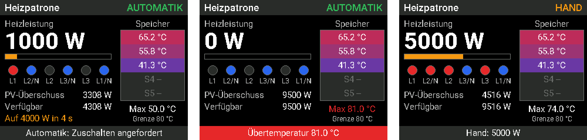
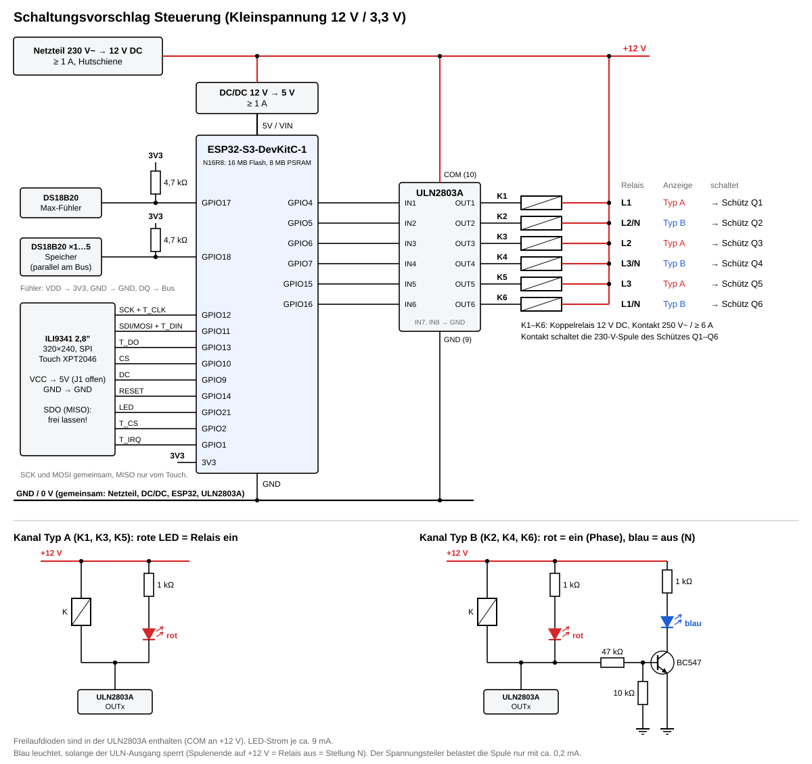
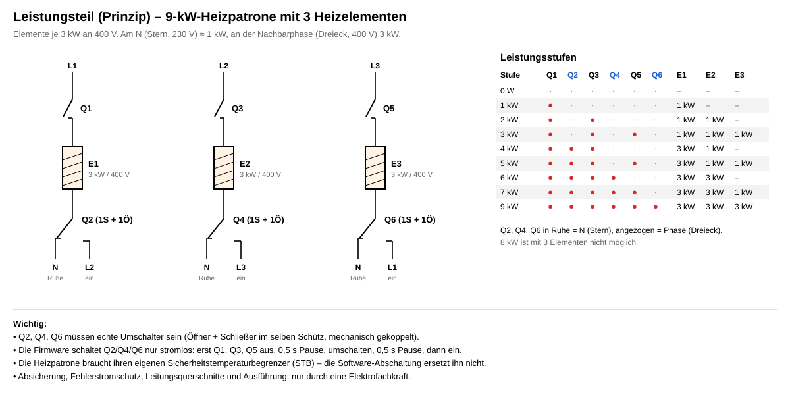

# ESPHome: Heizpatrone im Pufferspeicher (ESP32-S3 + Touch-Display)

Die Konfiguration [`heizpatrone.yaml`](heizpatrone.yaml) steuert eine 9-kW-Heizpatrone in 1-kW-Stufen über 6 Relais. Sie läuft auf einem ESP32-S3 mit 2,8"-Touch-Display, nutzt den PV-Überschuss aus Home Assistant und schaltet bei Übertemperatur ab. Am Display lassen sich Betriebsart, Handleistung und alle Parameter per Touch bedienen.



## Leistungsstufen

Laut Spezifikation (● = Relais ein):

| Leistung | K1 L1 | K2 L2/N | K3 L2 | K4 L3/N | K5 L3 | K6 L1/N |
|---------:|:-----:|:-------:|:-----:|:-------:|:-----:|:-------:|
| 0 W      |       |         |       |         |       |         |
| 1000 W   | ●     |         |       |         |       |         |
| 2000 W   | ●     |         | ●     |         |       |         |
| 3000 W   | ●     |         | ●     |         | ●     |         |
| 4000 W   | ●     | ●       | ●     |         |       |         |
| 5000 W   | ●     | ●       | ●     |         | ●     |         |
| 6000 W   | ●     | ●       | ●     | ●       |       |         |
| 7000 W   | ●     | ●       | ●     | ●       | ●     |         |
| 9000 W   | ●     | ●       | ●     | ●       | ●     | ●       |

Die Tabelle entspricht einer Heizpatrone mit **3 Heizelementen zu je 3 kW an 400 V**. Jedes Element hängt mit einem Ende an seiner Phase (K1, K3, K5) und mit dem anderen Ende am Umschalter K2, K4 oder K6:

- **Ruhestellung (aus):** Elementende liegt am **N** → Stern, 230 V, ca. **1 kW**
- **Angezogen (ein):** Elementende liegt an der **Nachbarphase** → Dreieck, 400 V, **3 kW**

Nachgerechnet ergibt jede Zeile der Tabelle genau die angegebene Leistung. 8 kW ist mit 3 Elementen nicht möglich, deshalb fehlt diese Stufe.

> **Hinweis zur Spezifikation:** Die 6. Spalte heißt dort ebenfalls „L2/N“. Elektrisch muss es **L1/N** sein: Das dritte Element (an L3) wird im Dreieck gegen L1 geschaltet. Die Logik folgt unverändert der Tabelle, nur die Bezeichnung ist angepasst.

### Umschalten nur stromlos

K2, K4 und K6 schalten ein Elementende zwischen **N und einer Phase** um. Würde das unter Last passieren, könnte der Abschaltlichtbogen Phase und N kurzschließen. Die Firmware hält deshalb immer diese Reihenfolge ein, wenn sich eines dieser Relais ändert:

1. Alle Phasenrelais K1, K3, K5 aus
2. 0,5 s Pause
3. K2, K4, K6 umschalten
4. 0,5 s Pause
5. Phasenrelais der neuen Stufe ein

Dafür sind die Relais in Home Assistant **nicht direkt schaltbar**, sondern nur als Anzeige sichtbar. Geschaltet wird ausschließlich über die Stufenlogik.

## Betriebsarten

Umschaltbar über die Entität **Betriebsart**.

### Automatik (PV-Überschuss)

Gerechnet wird mit der **verfügbaren Leistung** = gemessener PV-Überschuss + aktuell geschaltete Heizleistung. Ohne diese Kompensation würde jedes Zuschalten den Messwert sofort wieder unter die Schwelle drücken.

- **Einschalthysterese** (Standard 100 W): Eine Stufe wird zugeschaltet, wenn die verfügbare Leistung mindestens *Stufe + Einschalthysterese* beträgt.
- **Ausschalthysterese** (Standard 100 W): Eine Stufe wird verlassen, wenn die verfügbare Leistung unter *Stufe − Ausschalthysterese* fällt.
- **Einschalt- und Ausschaltverzögerung** (Standard 60 s / 30 s): So lange muss die Bedingung ununterbrochen anstehen. Kurze Wolken oder Lastspitzen lösen nichts aus.
- Nach Ablauf der Verzögerung springt die Regelung direkt auf die passende Stufe, auch über mehrere Stufen.
- Ohne Verbindung zu Home Assistant oder ohne PV-Wert wird nach der Ausschaltverzögerung abgeschaltet.

Beispiel mit Standardwerten für die 4-kW-Stufe: ein ab **4100 W** verfügbar, aus unter **3900 W**.

### Handbetrieb

Die Leistung wird über die Entität **Handleistung** oder am Display mit **−/+** vorgegeben (0 … 9000 W) und sofort geschaltet. Die Übertemperatur-Abschaltung gilt weiterhin. Der Handbetrieb läuft auch ohne Verbindung zu Home Assistant weiter. Beim Wechsel zurück auf Automatik regelt diese ab der aktuellen Stufe weiter.

## Maximaltemperatur

- Ein eigener DS18B20 am **Eingang 1** überwacht die Maximaltemperatur.
- Liegt der Messwert **über der Maximaltemperatur** (Standard 80 °C), werden sofort alle Relais abgeschaltet (0 W), in beiden Betriebsarten.
- **Wieder eingeschaltet** wird erst, wenn die Temperatur um die **Temperatur-Hysterese** gefallen ist (Standard 5 K, also bei 75 °C).
- **Liefert der Fühler keinen Messwert** (defekt, abgesteckt, kurz nach dem Start), bleibt ebenfalls alles aus.

> ⚠️ Diese Abschaltung ist eine Komfortfunktion, **keine Sicherheitseinrichtung**. Die Heizpatrone braucht ihren eigenen Sicherheitstemperaturbegrenzer (STB) bzw. Thermostat, der direkt die Leistung trennt. Die Maximaltemperatur am besten unter dem Thermostat der Patrone einstellen.

## Entitäten in Home Assistant

| Entität | Art | Bedeutung |
|---------|-----|-----------|
| **Betriebsart** | Auswahl | Automatik / Hand |
| **Handleistung** | Auswahl | 0 … 9000 W für den Handbetrieb |
| **Heizleistung** | Sensor | aktuell geschaltete Leistung |
| **Verfügbare Leistung** | Sensor | PV-Überschuss + Heizleistung |
| **Temperatur Max-Fühler** | Sensor | Fühler an Eingang 1 |
| **Speicher 1 (oben) … Speicher 5 (unten)** | Sensor | Temperaturverlauf im Speicher |
| **Übertemperatur** | Binärsensor | Abschaltung aktiv |
| **Relais K1 L1 … K6 L1-N** | Binärsensor | Relaiszustand (nur Anzeige) |
| **Status** | Text | z. B. „Automatik: 4000 W“, „Übertemperatur 81.0 °C“ |
| **Maximaltemperatur**, **Temperatur-Hysterese** | Einstellung | Übertemperatur-Abschaltung |
| **Einschalthysterese**, **Ausschalthysterese** | Einstellung | Automatik |
| **Einschaltverzögerung**, **Ausschaltverzögerung** | Einstellung | Automatik (10–900 s) |
| **Display-Beleuchtung** | Licht | Hintergrundbeleuchtung, dimmbar |
| **Display-Timeout** | Einstellung | Beleuchtung aus nach x Minuten ohne Berührung (0 = immer an) |

Einstellungen, Betriebsart und Handleistung bleiben nach einem Neustart erhalten. Die Werte unter `substitutions` sind nur die Startwerte beim ersten Flashen.

## Display und Touch-Bedienung

Das Display (2,8", 320 × 240) hat zwei Seiten.

**Übersicht**
- **Statuszeile oben:** z. B. „Automatik: 4000 W“, bei Übertemperatur rot
- **Heizleistung:** groß, mit Balken
- **Relais:** wie die LEDs im Schaltschrank, rot = ein, /N-Relais blau = aus
- **Automatik:** PV-Überschuss und verfügbare Leistung, mit Countdown bis zur nächsten Umschaltung
- **Handbetrieb:** stattdessen die Handleistung mit Knöpfen **−** und **+**
- **Speicher:** bis zu 5 Schichten, farbig von blau (kalt) bis rot (heiß); nicht vorhandene Fühler grau
- **Max-Fühler:** Messwert und Grenze
- **Knopf „Modus“:** wechselt zwischen Automatik (grün) und Hand (orange)
- **Knopf „Einstellungen“:** öffnet die zweite Seite

**Einstellungen**
- Maximaltemperatur, Temperatur-Hysterese, Ein- und Ausschalthysterese, Ein- und Ausschaltverzögerung, jeweils mit **−** und **+**
- Die Werte sind dieselben wie in Home Assistant und bleiben gespeichert.
- „Zurück zur Übersicht“, oder automatisch nach 60 s ohne Berührung

**Beleuchtung**
- Geht nach dem **Display-Timeout** aus (Standard 10 min, 0 = immer an).
- Die erste Berührung schaltet sie nur ein und löst noch keine Aktion aus.
- Bei Übertemperatur bleibt sie an.

Gedrückte Knöpfe leuchten kurz auf. Zwei Berührungen innerhalb von 0,3 s zählen als eine.

Zeigt dein Display falsche Farben oder ein Negativbild, beim `display:` die Optionen `invert_colors: true` bzw. `color_order: bgr` ergänzen. Steht das Bild auf dem Kopf, `rotation: 270` statt `90` eintragen und danach die Touch-Ausrichtung neu prüfen.

### Touch kalibrieren

Der resistive Touch (XPT2046) muss einmal auf das eigene Display abgestimmt werden. Die Werte stehen oben in der YAML unter `touch_…`.

1. Flashen und das Log öffnen (`esphome logs heizpatrone.yaml`, über WLAN oder per Kabel am Anschluss **USB**). Jede Berührung erscheint dort als `x=… y=… (roh x=… y=…)`.
2. Nacheinander **ganz links, ganz rechts, ganz oben und ganz unten** an den Rand tippen und die **Rohwerte** notieren.
3. Kleinster und größter Roh-x-Wert → `touch_x_min` / `touch_x_max`; dasselbe für y.
4. Prüfen, ob die Richtung stimmt:
   - **Achsen vertauscht** (nach rechts tippen ändert vor allem y): `touch_swap_xy` umstellen und Schritt 2 wiederholen.
   - **x gespiegelt** (Roh-x wird nach rechts *kleiner*): `touch_mirror_x: "true"`.
   - **y gespiegelt** (Roh-y wird nach unten *kleiner*): `touch_mirror_y: "true"`.
   - `min` muss immer kleiner als `max` sein, auch bei gespiegelter Achse.
5. Neu flashen. Die angezeigten `x`/`y` sollten jetzt etwa 0–320 bzw. 0–240 ergeben, und die Knöpfe reagieren dort, wo man tippt.

## Hardware

### ESP32-Empfehlung

**ESP32-S3-DevKitC-1-N16R8** von Espressif (Modul ESP32-S3-WROOM-1, 16 MB Flash, 8 MB Octal-PSRAM) mit **2,8"-TFT ILI9341 mit Touch (SPI, XPT2046)**.

- Aktuelle Variante laut Espressif, die Konfiguration ist genau darauf eingestellt.
- Genug freie GPIOs für 6 Relais, 2 Fühlerbusse, Display, Touch und Beleuchtung, ohne Boot- oder USB-Pins.
- **PSRAM:** Das ganze Bild wird im Speicher aufgebaut und in einem Zug übertragen. Kein Flackern, schnelle Reaktion auf Touch.
- Von ESPHome voll unterstützt.

**Im Metall-Schaltschrank** kommt das WLAN mit der Leiterplattenantenne oft nicht zuverlässig durch. Dann besser die Variante **ESP32-S3-DevKitC-1U-N16R8** mit Anschluss für eine externe Antenne nehmen und die Antenne außen am Schrank montieren. Die Konfiguration bleibt gleich.

**USB:** Das Board hat zwei Anschlüsse, **UART** und **USB**. Flashen geht über beide. Das Log gibt ESPHome per Kabel aber nur am Anschluss **USB** aus; über WLAN geht es unabhängig davon.

**Andere Varianten:** In der aktuellen Bestellliste von Espressif sind N8 und N8R2 als abgekündigt markiert, N8R8 steht gar nicht mehr darin. Wer schon so ein Board hat, kann es weiter verwenden und passt die YAML an:

| Board | Anpassung in der YAML |
|-------|-----------------------|
| N8R8 | `flash_groesse: 8MB` |
| N8R2 | `flash_groesse: 8MB`, bei `psram:` `mode: quad` |
| N8 (ohne PSRAM) | `flash_groesse: 8MB`, den Block `psram:` löschen. ESPHome zeichnet das Display dann in Teilen. |
| N32R16V (Modul WROOM-2, Octal-Flash, 1,8 V) | nicht getestet, nicht empfohlen |

Den Block `psram:` nur löschen, wenn wirklich kein PSRAM da ist. Steht er in der YAML, legt ESPHome den ganzen Bildpuffer an und erwartet dafür PSRAM.

### Stückliste (Vorschlag)

| Anzahl | Teil |
|-------:|------|
| 1 | ESP32-S3-DevKitC-1-N16R8 (im Metallschrank: ESP32-S3-DevKitC-1U-N16R8 mit externer Antenne) |
| 1 | TFT 2,8" ILI9341 mit Touch (XPT2046), SPI, 320 × 240 |
| 1 | ULN2803A (Darlington-Treiber, 8 Kanäle) |
| 6 | Koppelrelais 12 V DC, 1 Wechsler, 250 V~ / ≥ 6 A (z. B. Finder Serie 38, Hutschiene) |
| 6 | Installationsschütz 230-V-Spule, passend zur Patrone (z. B. 20/25 A); **Q2, Q4, Q6 mit 1 Schließer + 1 Öffner** |
| 2–6 | DS18B20 wasserdicht (für Tauchhülse) |
| 1 | Netzteil 12 V DC ≥ 1 A, Hutschiene (z. B. Mean Well HDR-15-12) |
| 1 | DC/DC-Wandler 12 V → 5 V, ≥ 1 A (z. B. Traco TSR 1-2450) |
| 3 | NPN-Transistor BC547 |
| 6 / 3 | LED rot / LED blau |
| 9 / 3 / 3 / 2 | Widerstand 1 kΩ / 47 kΩ / 10 kΩ / 4,7 kΩ |

### Schaltungsvorschlag Steuerung



**Signalweg:**
1. Der ESP32-S3 steuert über eine **ULN2803A** die Spulen von 6 **Koppelrelais (12 V)**. GPIO high bedeutet Relais ein.
2. Die Kontakte der Koppelrelais schalten die 230-V-Spulen der **Schütze Q1–Q6**.
3. Die Schütze schalten die Heizelemente.

Die Freilaufdioden für die Relaisspulen sind in der ULN2803A eingebaut (Pin 10 COM an +12 V).

**LED-Anzeigen laut Spezifikation:**
- **Typ A (K1, K3, K5):** Rote LED mit 1 kΩ parallel zur Spule, leuchtet bei *ein*.
- **Typ B (K2, K4, K6):** Rote LED wie Typ A. Zusätzlich eine blaue LED über einen Transistor-Inverter (BC547). Sie leuchtet, solange der ULN-Ausgang sperrt, also bei *aus* (Stellung N). Der Spannungsteiler 47 kΩ / 10 kΩ belastet die Spule dabei nur mit etwa 0,2 mA, das Relais bleibt sicher abgefallen.

**Belegung (ESP32-S3-DevKitC-1):**

| Funktion | ESP32-S3 | Anschluss |
|----------|----------|-----------|
| K1 L1 | GPIO4 | ULN2803A IN1 |
| K2 L2/N | GPIO5 | ULN2803A IN2 |
| K3 L2 | GPIO6 | ULN2803A IN3 |
| K4 L3/N | GPIO7 | ULN2803A IN4 |
| K5 L3 | GPIO15 | ULN2803A IN5 |
| K6 L1/N | GPIO16 | ULN2803A IN6 |
| Fühler Eingang 1 (Max) | GPIO17 | DS18B20 DQ, 4,7 kΩ nach 3V3 |
| Fühler Eingang 2 (Speicher) | GPIO18 | DS18B20 DQ (1–5 parallel), 4,7 kΩ nach 3V3 |
| SPI SCK | GPIO12 | Display SCK **und** Touch T_CLK |
| SPI MOSI | GPIO11 | Display SDI (MOSI) **und** Touch T_DIN |
| SPI MISO | GPIO13 | **nur** Touch T_DO (Display-SDO frei lassen, siehe unten) |
| Display CS | GPIO10 | CS |
| Display DC | GPIO9 | DC (bzw. RS) |
| Display RESET | GPIO14 | RESET |
| Display-Beleuchtung | GPIO21 | LED |
| Touch CS | GPIO2 | T_CS |
| Touch IRQ | GPIO1 | T_IRQ |
| Versorgung ESP32-S3 | 5V, GND | vom DC/DC-Wandler |
| Display VCC | 5V, GND | J1 auf dem Modul offen lassen (siehe unten) |
| Fühler VDD | 3V3, GND | VDD |

Bewusst **nicht** belegt:

| GPIO | Grund |
|------|-------|
| 0, 3, 45, 46 | Boot |
| 19, 20 | USB |
| 26–37 | Flash/PSRAM |
| 38, 48 | RGB-LED des Boards |
| 43, 44 | UART |

Alle Pins lassen sich oben in der YAML unter `substitutions` ändern.

#### Displaymodul anschließen

Die üblichen 2,8"-Module (ILI9341 mit Touch XPT2046, 14-polige Stiftleiste) haben ein paar Eigenheiten:

| Modul-Pin | Anschluss | Hinweis |
|-----------|-----------|---------|
| VCC | 5V | Das Modul hat einen eigenen 3,3-V-Regler, die Lötbrücke **J1 bleibt offen**. Alternativ VCC an 3V3, dann **J1 schließen**. An 3V3 mit offenem J1 läuft das Modul unterversorgt. |
| GND | GND | |
| CS | GPIO10 | |
| RESET | GPIO14 | |
| DC | GPIO9 | |
| SDI (MOSI) | GPIO11 | |
| SCK | GPIO12 | |
| LED | GPIO21 | Am LED-Pin sitzt ein Transistor, der GPIO kann direkt schalten und dimmen. |
| **SDO (MISO)** | **frei lassen** | Viele ILI9341 geben die Leitung auch dann nicht frei, wenn sie nicht angesprochen sind, und stören damit den Touch. ESPHome liest vom Display nie etwas. |
| T_CLK | GPIO12 | zusammen mit SCK |
| T_CS | GPIO2 | |
| T_DIN | GPIO11 | zusammen mit SDI (MOSI) |
| T_DO | GPIO13 | einziges Signal an MISO |
| T_IRQ | GPIO1 | |

Die Signalleitungen arbeiten in beiden Versorgungsvarianten mit 3,3 V und passen direkt zum ESP32-S3. Die SD-Karten-Pins an der Seite bleiben frei.

Fehlt bei deinem Modul der Transistor am LED-Pin (LED hängt direkt an den Leuchtdioden), LED fest an 3V3 legen. Dann funktioniert alles außer Dimmen und Timeout.

### Leistungsteil (Prinzip)



> ⚠️ **Nur durch eine Elektrofachkraft.** Der Leistungsteil arbeitet mit 400 V und bis zu 9 kW. Die Zeichnung zeigt nur das Prinzip, das der Schaltlogik zugrunde liegt. Absicherung, Fehlerstromschutz, Querschnitte, STB und Ausführung gehören in die Hand einer Elektrofachkraft. **Q2, Q4 und Q6 müssen echte Umschalter sein** (Öffner und Schließer im selben Schütz, mechanisch gekoppelt), damit N und Phase nie gleichzeitig verbunden sein können.

## Einrichtung

1. `secrets.yaml.example` nach `secrets.yaml` kopieren und eintragen:

   | Schlüssel | Inhalt |
   |-----------|--------|
   | `wifi_ssid` | Name des WLANs |
   | `wifi_password` | WLAN-Passwort |
   | `api_encryption` | API-Schlüssel, z. B. mit `openssl rand -base64 32` erzeugen; wird auch für verschlüsselte OTA-Updates verwendet |
   | `fallback_ap_password` | Passwort des Notfall-Hotspots (mind. 8 Zeichen) |

2. Unter `substitutions` bei `pv_sensor` die Entität deines PV-Überschuss-Sensors eintragen.
   - Ist bei deinem Sensor die Einspeisung **negativ**: beim `homeassistant`-Sensor den Filter `multiply: -1` einkommentieren.
3. Erstes Flashen per USB:
   ```bash
   esphome run heizpatrone.yaml
   ```
   Flashen geht über beide USB-Anschlüsse, das Log per Kabel nur über **USB**. Danach geht beides auch über WLAN. Benötigt eine aktuelle ESPHome-Version (getestet mit 2026.10); ältere Versionen kennen `encryption` bei `ota` noch nicht.
4. **Touch kalibrieren**, siehe oben.
5. **Speicherfühler zuordnen:**
   - Im Log stehen beim Start die gefundenen Adressen je Bus.
   - Bei den Sensoren `Speicher 1 … 5` jeweils `index: X` durch `address: 0x…` ersetzen, sodass *Speicher 1* der oberste Fühler ist.
   - Nicht vorhandene Fühler aus der YAML löschen.
6. **Erst ohne Leistungsteil testen:**
   - Mit abgeklemmten Schützen im Handbetrieb alle Stufen durchschalten (am Display mit −/+).
   - Relais und LEDs mit der Tabelle oben vergleichen.
   - Bei Stufenwechseln mit K2/K4/K6 auf die Pausen achten.

## Anpassen

Unter `substitutions` in der YAML:

- `pv_sensor`: Entität des PV-Überschuss-Sensors
- `stufen_leistung`, `stufen_relais`: Leistungsstufen und Relaismuster (Reihenfolge K1 … K6). Bei Änderungen auch die Optionen von *Handleistung* anpassen.
- `umschaltpause`: Pause beim Umschalten der /N-Relais (Standard 500 ms)
- Startwerte: `max_temperatur`, `temperatur_hysterese`, `einschalthysterese`, `ausschalthysterese`, `einschaltverzoegerung`, `ausschaltverzoegerung`, `display_timeout`
- `flash_groesse`: Flash des S3-Moduls
- `touch_…`: Touch-Kalibrierung
- `pin_…`: alle GPIOs
- `knopf_…`, `einstellungen_layout`: Lage der Touch-Knöpfe (normalerweise nicht ändern; gilt für Anzeige und Touch gemeinsam)
