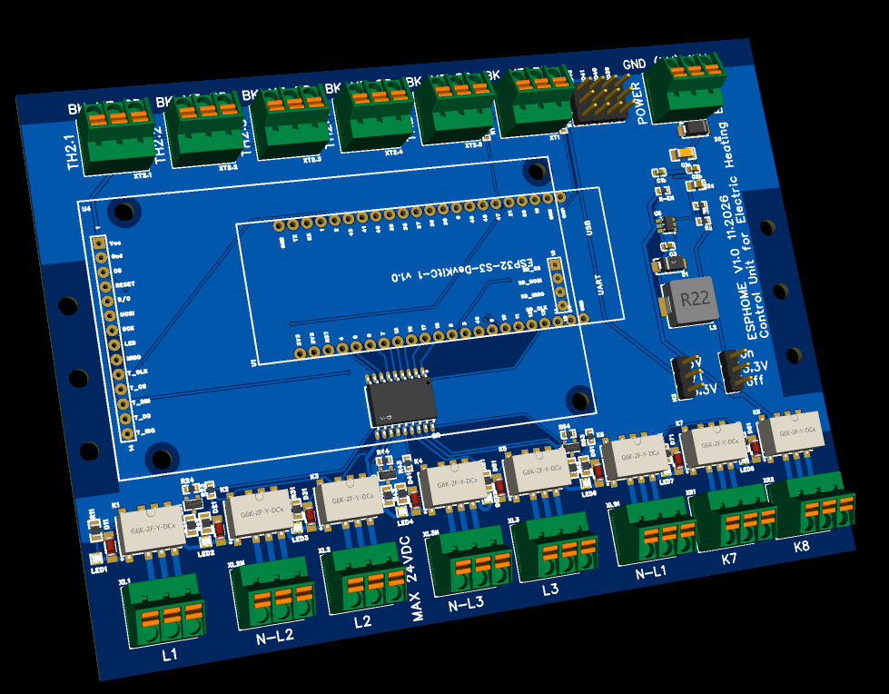

# Steuerplatine „ESPHOME V1.0“ (EasyEDA Pro)

Platine für die Heizpatronen-Steuerung: ESP32-S3-DevKitC-1 und 2,8"-Touch-Display gesteckt, 8 Koppelrelais für die Schützspulen, Klemmen für 6 Temperaturfühler und die 12-V-Versorgung. Die Firmware ist [`heizpatrone.yaml`](../heizpatrone.yaml); die GPIO-Belegung der Platine entspricht genau der Konfiguration.

## Dateien

| Datei | Inhalt |
|-------|--------|
| [`ESPHOME_Heizstab_Regelung.epro2`](ESPHOME_Heizstab_Regelung.epro2) | komplettes EasyEDA-Pro-Projekt (Schaltplan, Platine, Bauteile). In EasyEDA Pro über *Datei → Öffnen* bzw. *Projekt importieren* laden. |
| [`PCB1.epro2`](PCB1.epro2) | nur das Platinen-Dokument (PCB1) |
| [`schaltplan/schaltplan-P1.svg`](schaltplan/schaltplan-P1.svg) | Schaltplan Blatt 1: ESP32-S3, ULN2803A, Fühler, Display, Reserve-Pins |
| [`schaltplan/schaltplan-P2.svg`](schaltplan/schaltplan-P2.svg) | Schaltplan Blatt 2: Relais K1–K8 mit LEDs und Klemmen |
| [`schaltplan/schaltplan-P3.svg`](schaltplan/schaltplan-P3.svg) | Schaltplan Blatt 3: 12-V-Eingang, Verpolschutz, 3,3-V-Regler, Jumper |
| [`BOM_Board1.xlsx`](BOM_Board1.xlsx) | Stückliste aus EasyEDA mit LCSC-Bestellnummern |
| [`Gerber_PCB1.zip`](Gerber_PCB1.zip) | Fertigungsdaten: Gerber (Kupfer oben/unten, Lötstopp, Bestückungsdruck, Pastenmaske, Umriss), Bohrdaten (Excellon) und Flying-Probe-Testdaten. Die ZIP-Datei unverändert beim Leiterplattenhersteller hochladen. |

Die Gerber-Daten entsprechen genau dem Projekt im Repo: gleiche Netze, gleiche Bauteilpositionen. Die Bestückungsdatei (Pick and Place) für eine SMD-Bestückung beim Hersteller erzeugt EasyEDA Pro bei Bedarf aus dem Projekt.

### Fertigungsdaten

| | |
|-|-|
| Lagen | 2, FR4 1,6 mm, Kupfer 35 µm |
| Kleinste Leiterbahn | 0,25 mm |
| Bohrungen durchkontaktiert | 125 für Bauteile (0,8 / 1,0 / 1,1 / 1,5 mm) und 24 Vias (0,3 mm) |
| Bohrungen nicht durchkontaktiert | 6 × 3,2 mm (Befestigung) und 4 × 3,3 mm (Display) |
| Bestückungsdruck | nur oben |

## Eckdaten

| | |
|-|-|
| Größe | 140 × 100 mm |
| Lagen | 2 (oben und unten), FR4 1,6 mm, Kupfer 35 µm |
| Bestückung | alle Bauteile oben; SMD und bedrahtet (Klemmen, Stiftleisten, Buchsenleisten) |
| Kupferflächen | GND auf beiden Seiten |
| Leiterbahnen | 0,25 / 0,5 / 0,64 / 1,0 mm |
| Vias | Bohrung 0,3 mm, Ring 0,6 mm |
| Befestigung | 6 Löcher Ø 3,2 mm (M3), je 3 am linken und rechten Rand, senkrecht im Abstand von 12,5 mm (37,6 / 50,0 / 62,5 mm über der Unterkante), Lochmitte links 3,6 mm und rechts 4,4 mm vom Rand |
| Randzonen | links und rechts je 8 × 40 mm (30–70 mm über der Unterkante) ohne Kupfer und Bauteile, für Halter oder Gehäuseführung |
| Versorgung | 12 V DC, ca. 0,4 A (ohne Schützspulen) |
| Aufdruck | „ESPHOME V1.0 11.2026 – Control Unit for Electric Heating Element“ |

## Aufbau

- **12-V-Eingang:** Klemme X12V → Verpolschutz D2 (SS34, ca. 0,45 V Abfall) → 12-V-Netz für ULN2803A, Relais und Regler.
- **3,3 V:** Schaltregler U5 (AOZ1282CI, 0,8 V × (1 + 49,9 kΩ / 15,8 kΩ) = 3,33 V) speist über Jumper H2 den 3V3-Pin des DevKit.
- **ESP32-S3-DevKitC-1 (U1):** gesteckt; die Pins 1–22 liegen unten, USB und UART zeigen nach rechts.
- **Display (U4):** 2,8" ILI9341 mit Touch, 14-polige Leiste; liegt **über** dem DevKit.
- **Relais:** ULN2803A (U3) treibt 8 × Omron G6K-2F-Y DC12 (K1–K8). Freilaufdioden: in der ULN2803A (COM an 12 V) und zusätzlich D11–D81 direkt an den Spulen.
- **Anzeige:** je Relais eine Zweifarben-LED (rot/blau).
- **Fühler:** DS18B20 an IO8 (Max-Fühler) und IO47 (Speicher), je 4,7 kΩ Pull-up an VT.

## Anschlüsse

Klemmen KF250NH, Raster 3,5 mm. Pin 1 liegt bei den oberen Klemmen jeweils **rechts**, bei den unteren **links**.

### Oben: Versorgung und Fühler

| Aufdruck | Klemme | Pin 1 | Pin 2 | Pin 3 |
|----------|--------|-------|-------|-------|
| POWER „GND (5V) 12V“ | X12V | **+12 V** (rechts) | 5V – **nicht belegen** | GND (links) |
| THmax | XT1 | VT 3,3 V – rot (RD) | DQ → IO8 – gelb (YE) | GND – schwarz (BK) |
| TH2.1 … TH2.5 | XT2.1 … XT2.5 | VT 3,3 V – rot (RD) | DQ → IO47 – gelb (YE) | GND – schwarz (BK) |

- Der Aufdruck „BK YE RD“ zeigt die Aderfarben von links nach rechts. Die Farben sind bei den meisten wasserdichten DS18B20 so; bei anderen Fühlern das Datenblatt prüfen.
- TH2.1–TH2.5 hängen parallel am selben Bus. Die Zuordnung *Speicher 1 … 5* erfolgt über die Fühleradressen in der YAML, nicht über die Klemme.
- Pin 2 von X12V (5V) ist direkt mit dem 5V-Pin des DevKit verbunden. Die Platine wird **nur mit 12 V** versorgt; an 5V nichts anschließen.

### Unten: Relaisausgänge

| Aufdruck | Klemme | Relais | GPIO | schaltet |
|----------|--------|--------|------|----------|
| L1 | XL1 | K1 | GPIO4 | Schütz Q1 |
| N-L2 | XL2N | K2 | GPIO5 | Schütz Q2 (Umschalter) |
| L2 | XL2 | K3 | GPIO6 | Schütz Q3 |
| N-L3 | XL3N | K4 | GPIO7 | Schütz Q4 (Umschalter) |
| L3 | XL3 | K5 | GPIO15 | Schütz Q5 |
| N-L1 | XL1N | K6 | GPIO16 | Schütz Q6 (Umschalter) |
| K7 | XR1 | K7 | GPIO17 | frei (Home Assistant) |
| K8 | XR2 | K8 | GPIO18 | frei (Home Assistant) |

Belegung jeder Relaisklemme (laut Bauteilsymbol; vor dem ersten Anschluss mit dem Durchgangsprüfer kontrollieren):

| Pin | Kontakt |
|-----|---------|
| 1 (links) | Öffner (NC), in Ruhe mit Pin 2 verbunden |
| 2 (Mitte) | gemeinsamer Kontakt (COM) |
| 3 (rechts) | Schließer (NO), bei angezogenem Relais mit Pin 2 verbunden |

**Belastbarkeit: höchstens 24 V DC (Aufdruck „MAX 24VDC“) und 1 A.** Die G6K-Relais und die Platine sind nur für Kleinspannung ausgelegt; **keine Netzspannung** anschließen. Für 230-V-Lasten an K7/K8 ein Schütz oder Koppelrelais dazwischen setzen.

**Schütz anschließen (12-V-DC-Spule):**
1. Pin 2 (COM) ← +12 V vom Netzteil, über die Sicherung für die Schützspulen
2. Pin 3 (Schließer) → Schütz A1
3. Schütz A2 → 0 V des Netzteils
4. Freilaufdiode direkt am Schütz (z. B. 1N4007, Kathode an A1), falls das Schütz keine eingebaut hat

Pin 1 (Öffner) bleibt frei. Strombilanz und Absicherung siehe [12-V-Versorgung](../README.md#12-v-versorgung-mean-well-hdr-60-12).

### Reserve: IO39–IO42

Vier 3-polige Stiftleisten (2,54 mm) zwischen THmax und POWER, je Pin 1 = IO39 … IO42 (zur Platinenmitte), Pin 2 = 3,3 V, Pin 3 = GND (zum Rand). In der YAML noch nicht verwendet.

## Jumper

| Jumper | Aufdruck | Stellung im Betrieb | Bedeutung |
|--------|----------|---------------------|-----------|
| H2 | on / 3,3V / off | **on – 3,3V** | Der 3,3-V-Regler speist den 3V3-Pin des DevKit. In Stellung *3,3V – off* ist der Regler abgetrennt, z. B. zum Flashen über USB bei eingeschalteten 12 V. Die Ausgangskondensatoren C2a/C2b sitzen hinter H2; der Regler soll deshalb nicht längere Zeit mit 12 V und abgezogenem Jumper laufen. |
| H3 | 5V / VT / 3,3V | **3,3V – VT** | VT (Versorgung der Fühler, ihrer Pull-ups und des Displays) = 3,3 V. Die Stellung *5V – VT* **nicht verwenden**: Dann liegen die Datenleitungen der Fühler über die Pull-ups an 5 V, und die GPIOs des ESP32-S3 vertragen keine 5 V. |

## LEDs

| LED | rot | blau |
|-----|-----|------|
| LED1, 3, 5, 7, 8 (K1, K3, K5, K7, K8) | Relais ein | – (nicht angeschlossen) |
| LED2, 4, 6 (K2, K4, K6) | Relais ein (Phase) | Relais aus (Stellung N) |

## Bestückung und Montage

- **DevKit:** ESP32-S3-DevKitC-1-N16R8 in zwei Buchsenleisten 1 × 22, Raster 2,54 mm.
- **Display:** in eine 14-polige Buchsenleiste (2,54 mm) an U4. Die 4 SD-Karten-Pins (15–18) sind nicht angeschlossen. Am Display die Lötbrücke **J1 schließen**, weil VCC hier an 3,3 V liegt.
- **Bohrungen für U4:** Sie sind nur 0,8 mm groß. Leisten mit den üblichen 0,64-mm-Vierkantstiften (Diagonale ca. 0,9 mm) passen dort nicht. Nur Buchsenleisten mit dünneren Lötstiften verwenden oder die Bohrungen im Footprint auf 1,0 mm vergrößern, wie beim DevKit.
- **Bauhöhe:** Das Display liegt über dem DevKit. Das DevKit steht in Buchsenleisten samt Modul etwa 13–16 mm hoch, und das Display muss mit seinen Bauteilen auf der Rückseite frei darüber stehen. Dafür eine entsprechend hohe Buchsenleiste bzw. Stiftleisten-Verlängerung für U4 und passende Abstandsbolzen verwenden. Am besten vor der Bestellung mit den echten Teilen nachmessen.
- **Befestigungslöcher für das Display:** 4 × Ø 3,3 mm im Abstand von 76,2 × 43,2 mm; auf der Unterseite ist darum Platz für Schraubenköpfe (Ø 6 mm frei). Lochabstand mit dem eigenen Displaymodul vergleichen.
- **USB:** Die USB-Buchsen des DevKit ragen rechts unter dem Display hervor und bleiben zugänglich.
- **WLAN:** Die Antenne des DevKit (linkes Ende, bei Pin 1) liegt unter dem Display und über der GND-Fläche. Das kann die Reichweite verringern. Bei schwachem Empfang, besonders im Metall-Schaltschrank, das **ESP32-S3-DevKitC-1U-N16R8** mit externer Antenne nehmen.

## Inbetriebnahme

1. **Jumper setzen:** H2 auf *on – 3,3V*, H3 auf *3,3V – VT*.
2. **Regler prüfen:** noch ohne DevKit und Display 12 V anlegen. An einer Reserve-Stiftleiste zwischen Pin 2 und Pin 3 (GND) etwa 3,3 V messen. 12 V wieder abschalten.
3. **Display vorbereiten:** J1 am Display schließen, dann DevKit und Display stecken.
4. **Erstes Flashen per USB:** dabei die 12 V abgeschaltet lassen (oder H2 auf *off*), damit nicht zwei Regler gleichzeitig das 3,3-V-Netz speisen. Danach gehen Updates über WLAN.
5. **Relais testen:** 12 V an, Schütze noch nicht angeschlossen. Im Handbetrieb alle Stufen durchschalten und Relais-LEDs mit der Tabelle im [Haupt-README](../README.md#leistungsstufen) vergleichen.

## Stückliste

Aus [`BOM_Board1.xlsx`](BOM_Board1.xlsx) (80 Bauteile, alle bei LCSC erhältlich):

| Anzahl | Wert | Bezeichner | Bauform | Hersteller-Teil | LCSC |
|-------:|------|------------|---------|-----------------|------|
| 1 | 10 µF / 25 V | C1a | 1206 | CL31B106KAHNNNE | C14860 |
| 1 | 100 nF / 50 V | C1b | 0603 | CC0603JRX7R9BB104 | C91183 |
| 1 | 22 µF / 6,3 V | C2a | 0805 | CL21A226MQQNNNE | C5674 |
| 2 | 100 nF / 16 V | C2b, C3 | 0603 | CC0603KRX7R7BB104 | C108079 |
| 1 | SS24 | D1 | SMA | SS24 | C50229768 |
| 1 | SS34 | D2 | SMA | SS34 | C52023881 |
| 8 | LL4148 | D11, D21, D31, D41, D51, D61, D71, D81 | MiniMELF (LL-34) | LL4148 | C3011166 |
| 6 | Stiftleiste 1 × 3 | H2, H3, IO39, IO40, IO41, IO42 | THT 2,54 mm | HX PH254-01-03-Z-L11.5 | C52016391 |
| 8 | G6K-2F-Y DC12 | K1–K8 | SMD | G6K-2F-Y DC12 | C397194 |
| 1 | 22 µH | L2 | SMD 8,7 × 8,1 mm | YSPI0840-220M | C5278948 |
| 8 | LED rot/blau | LED1–LED8 | SMD 1,6 × 1,5 mm, 4 Pins | NCD0604R1B1 | C41378546 |
| 3 | BC847 | Q21, Q41, Q61 | SOT-23 | BC847 | C475630 |
| 1 | 49,9 kΩ | R1 | 0603 | 0603WAF4992T5E | C23184 |
| 1 | 15,8 kΩ | R2 | 0603 | FRC0603F1582TS | C2960716 |
| 11 | 1 kΩ | R11, R21, R22, R31, R41, R42, R51, R61, R62, R71, R81 | 0805 | FRC0805F1001TS | C2907232 |
| 3 | 47 kΩ | R23, R43, R63 | 0603 | FRC0603F4702TS | C2907042 |
| 3 | 10 kΩ | R24, R44, R64 | 0603 | RS-03K103JT | C73809 |
| 1 | 100 kΩ | R-EN | 0603 | FRC0603F1003TS | C2906980 |
| 2 | 4,7 kΩ | RT1, RT2 | 0603 | CR0603J4K70P05Z | C881124 |
| 1 | ULN2803A | U3 | SOP-18 | ULN2803A | C845537 |
| 1 | AOZ1282CI | U5 | SOT-23-6 | AOZ1282CI | C111916 |
| 15 | Klemme 3-polig | X12V, XL1, XL1N, XL2, XL2N, XL3, XL3N, XR1, XR2, XT1, XT2.1–XT2.5 | THT, Raster 3,5 mm | KF250NH-3.5-3P | C976557 |

**Nicht in der BOM, separat besorgen:**

| Anzahl | Teil |
|-------:|------|
| 1 | ESP32-S3-DevKitC-1-N16R8 (oder -1U-N16R8 mit externer Antenne) |
| 2 | Buchsenleiste 1 × 22, Raster 2,54 mm (für das DevKit) |
| 1 | Display 2,8" ILI9341 mit Touch XPT2046, SPI, 14-polige Leiste |
| 1 | Buchsenleiste 1 × 14, Raster 2,54 mm, passend hoch (für das Display, siehe Bauhöhe) |
| 4 | Abstandsbolzen M3 mit Schrauben (für das Display) |
| 2 | Jumper 2,54 mm (für H2 und H3) |
